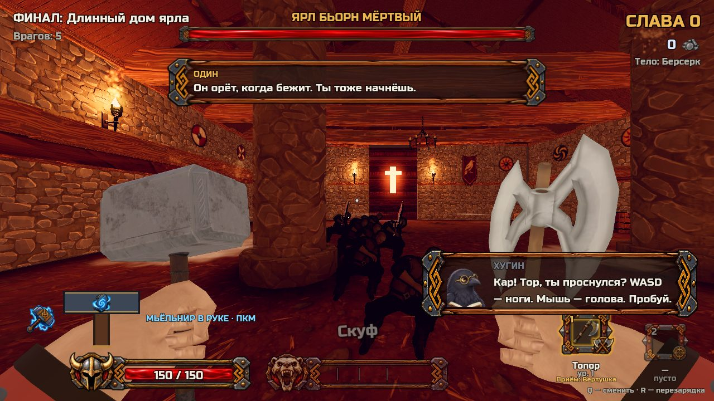
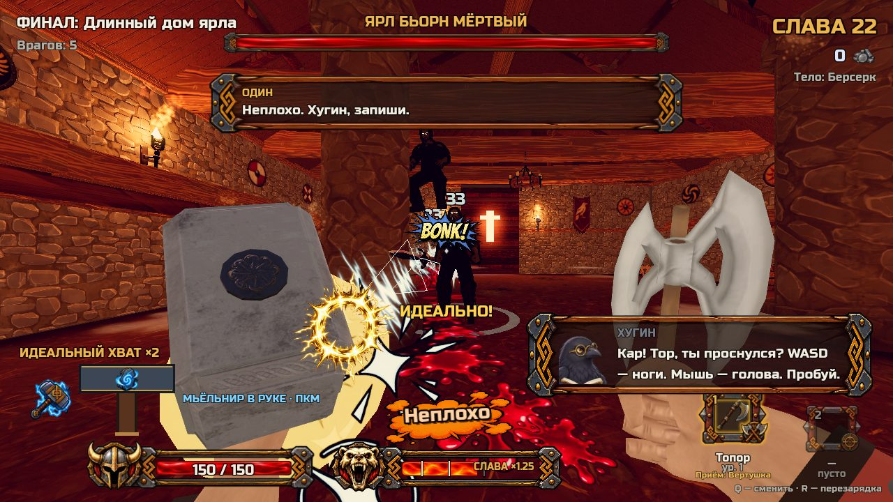
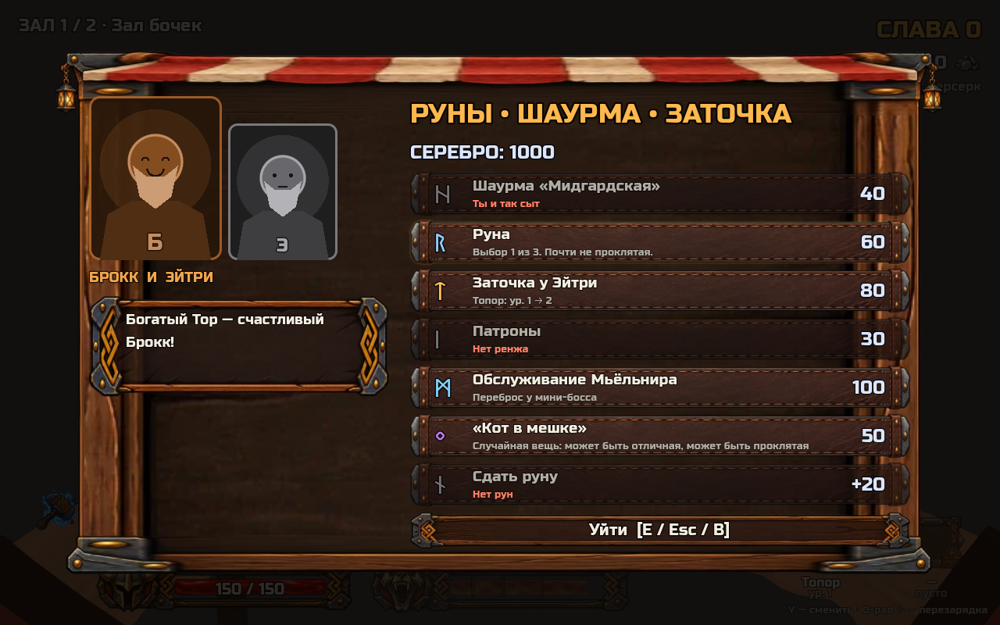

# Тор: Достойная смерть

**Топор, возвращающийся Мьёльнир и очень недовольный Один**

Godot 4.6 · Jolt Physics · Roguelite FPS · Прототип

[Запуск и управление](PROGRESS.md) · [Настройка баланса](TUNING.md) · [Источники и авторы](CREDITS.md)

| Идеальный перехват Мьёльнира | Лавка между сражениями |
| --- | --- |
|  |  |

*Кадры игрового прототипа из материалов разработки. Проект находится в разработке; состав забега и баланс меняются. Нажмите на изображение, чтобы открыть его целиком.*

---

## О проекте

Прототип рогалик-шутера от первого лица на Godot 4.6 (физика Jolt).

Один выгнал обленившегося Тора из Асгарда. Дух Тора вселяется в случайных смертных — каждый забег новое тело. Пройди залы, набери Славу и умри достойно (или победи Хримтурса).

- Движение: двойной прыжок, рывок, удар-приземление, супер-прыжок
- Топор с комбо из 3 ударов и Мьёльнир, который возвращается в руку
- Физика: бочки, отбрасывание, оглушение об стену, разлетающиеся трупы
- 6 залов + босс, руны, 3 тела, саркастичный Один

Как запустить, управление и что сделано — в [PROGRESS.md](PROGRESS.md). Где крутить числа — [TUNING.md](TUNING.md). Источники — [CREDITS.md](CREDITS.md).

Основа — [Kenney Starter Kit FPS](https://github.com/KenneyNL/Starter-Kit-FPS) (MIT / CC0).
