# Отчёт за ночь 26→27.10.2026

**Итог:** все блоки `NIGHT_TASKS.md` (А–У) сделаны. Сделаны и пункты «если всё сделано»: обучение, локализация, «Сообщить о лаге». Сверх списка — полиш, оптимизация и план развития `ROADMAP.md`. По GDD это вертикальный срез Мидгарда (веха M2). Не проверено главное: насколько весело играть живым людям (см. «Что дальше»).

- **Сборка для игры:** ветка `builds`, файл `ThorDostoynayaSmert-windows.zip` (76 МБ). Собрана из `main` @ 72d8f4a. Распаковать и запустить `ThorDostoynayaSmert.exe`. Если Windows ругается: «Подробнее» → «Выполнить в любом случае».
- **Проверки:** 26 тестов, 1560 проверок, 0 FAIL. Фризов > 50 мс вне загрузки нет.
- **Не проверено:** сборку под Windows запустить негде (на сервере нет Windows), `--selftest` для `.exe` не прогонялся.

## Скриншоты

Кадры с программного рендера (GL Compatibility, 1280×720). На видеокарте картинка будет чище.

| | |
|---|---|
| 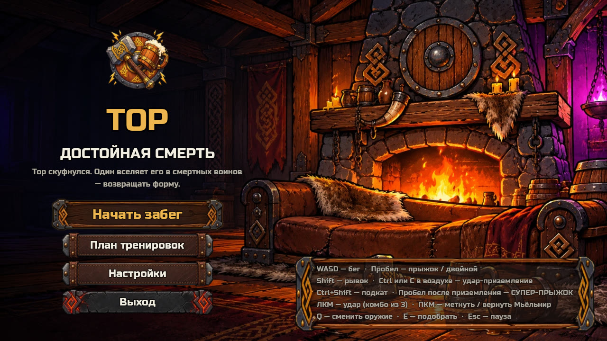 Главное меню на твоём UI-комплекте | 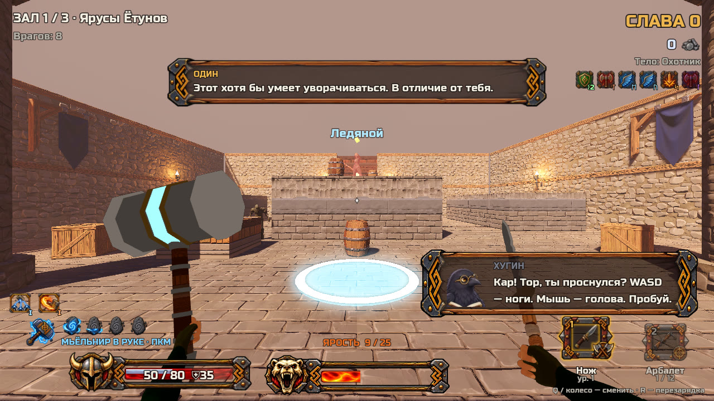 HUD в бою: HP со щитом Сиф, Мьёльнир, Ярость, слоты оружия, руны; обучение от Хугина; прыжковая руна на полу |
| 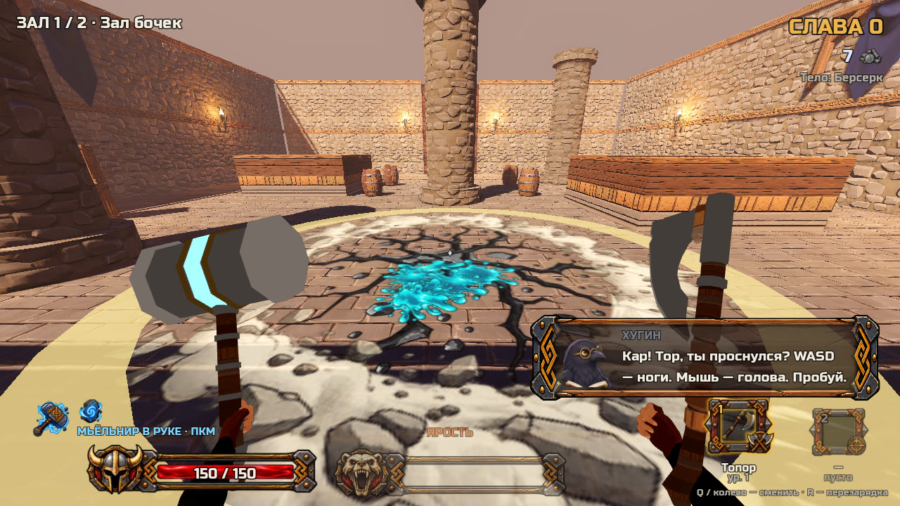 Удар-приземление: ударная волна, трещина, ихор (VFX-комплект) | 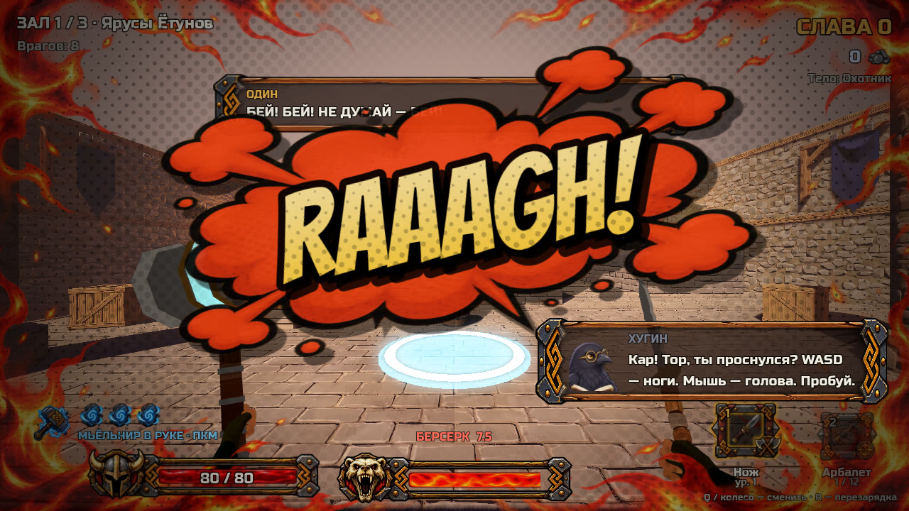 Берсерк: виньетка Ярости, «RAAAGH!» |
| 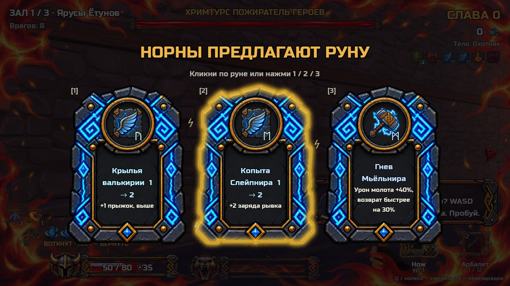 Выбор руны: карточки комплекта | 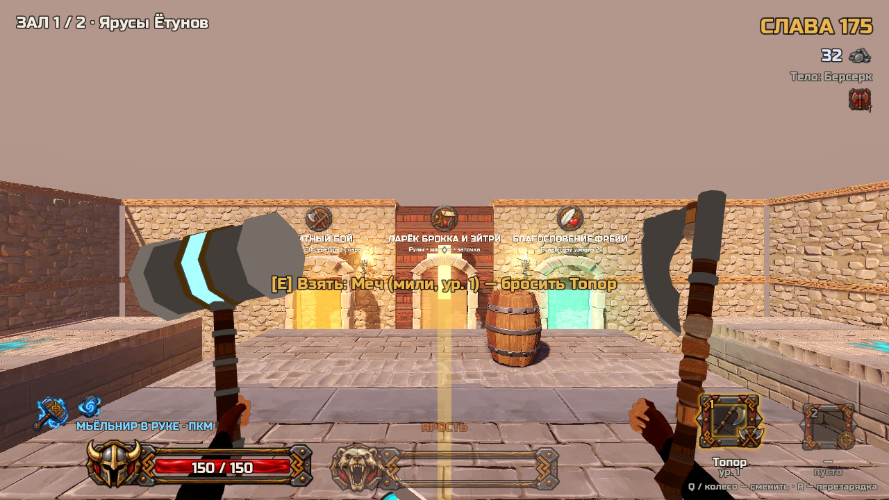 Двери-награды после зачистки: элита, ларёк, Фрейя |
| 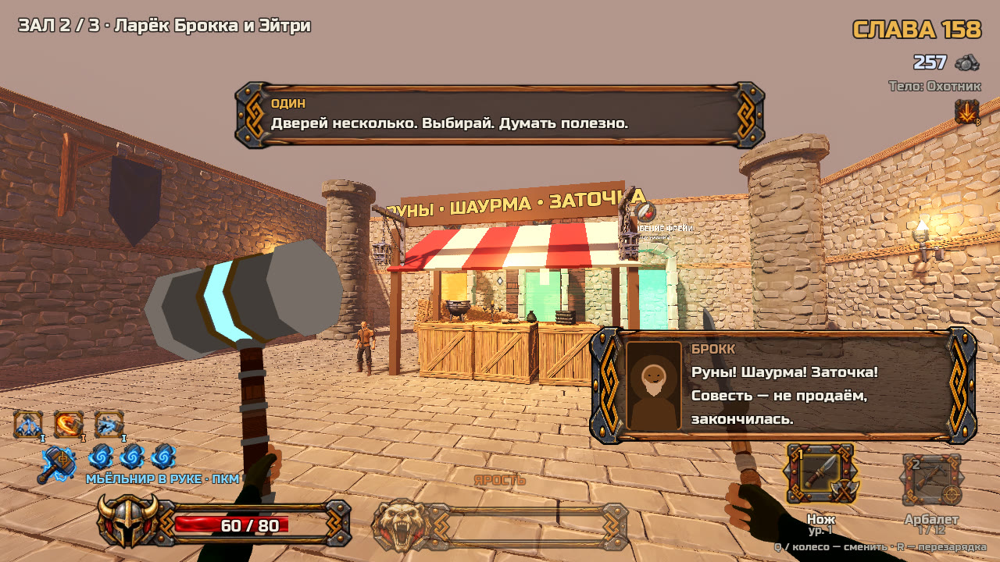 Ларёк Брокка и Эйтри | 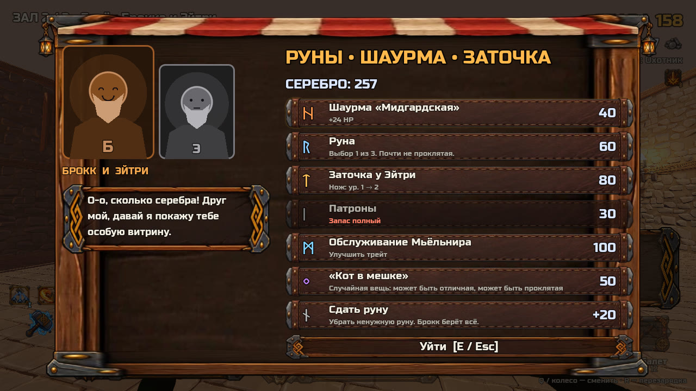 Товары ларька и серебро |
| 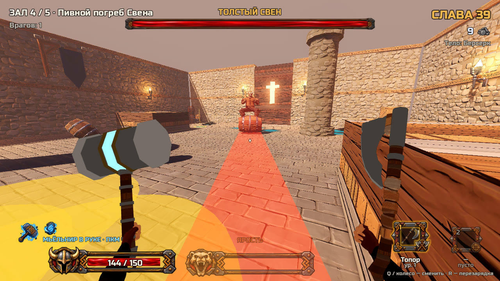 Толстый Свен готовит таран: красная полоса — путь | 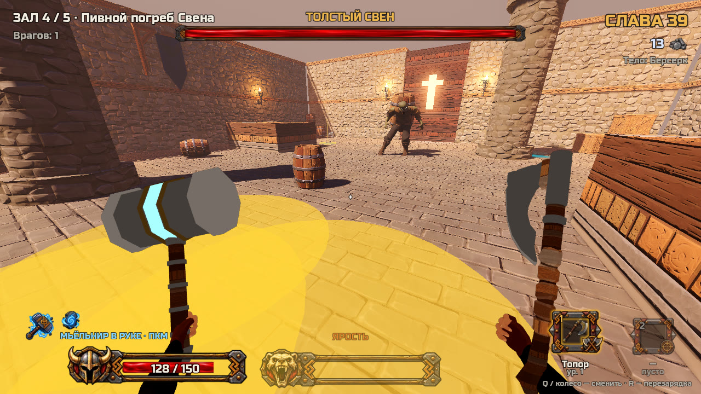 Лужи браги Свена замедляют |
| 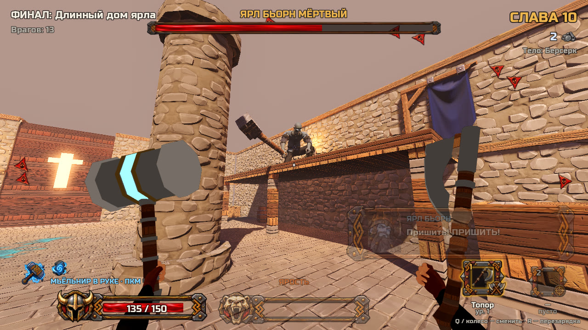 Ярл Бьорн, фаза 2: на балконе пришивает руку; по краям — стрелки на врагов за экраном | 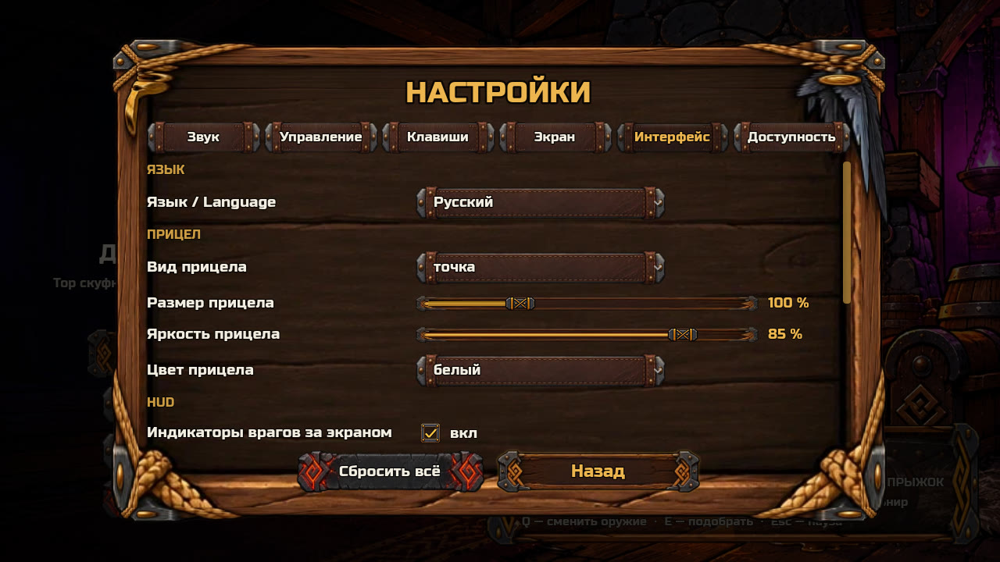 Настройки, вкладка «Интерфейс» (язык, прицел, индикаторы) |

## Что сделано

| Блок | Что | Коммит в `main` |
|---|---|---|
| А, Б, В | Диалоги-новеллы, сюжетная библия (черновик), сохранения, «План тренировок» | 41faa3c |
| Д | Прыжки GDD 7.2: отскок от удара-приземления, прыжок по головам, залезание на уступ, отскок от стены; потом пике, отмена удара-приземления рывком, прыжковые руны | 03fe331, c8f7382, 944a847 |
| Г | Данные по GDD: враги, руны, тела, пассивки; Слава по экономике GDD 15.2 | 6fbf3be |
| Ж | Оружие по забегу: 9 мили и 7 ренж (+ гвоздомёт и ракетница с рокет-джампом) | 60a206b, 61cbccf |
| Е, М | Комиксовые слова; все 13 трейтов Мьёльнира, идеальный хват | 767cb96, 1097d32, bd71747 |
| Р | Адаптивная музыка: слои, переходы в такт, приглушение на паузе, стингер (синтез-заглушки) | a8103a9 |
| Л, П | 9 тел со стилями движения, пассивки и изъяны, подкат; Ярость и берсерк, бой-реплики Одина | 698b49d |
| Т | Руны по GDD 11: уровни 1–3, 25 рун с механикой, криты, щит Сиф, проклятые руны Локи | 4d4d45e |
| З, У | Враги Мидгарда: корм, Раздутый, Щитоносец, Шаман, Наёмник Локи; волны потоком; 7 модификаторов элиты | e10642f |
| И, К, Ф | Двери-награды (7 залов), ларёк Брокка и Эйтри, серебро, испытания Одина, Хильд и Локи | 86ce495 |
| Н, О | Толстый Свен (своя арена, таран на бочке, брага, раздувание); Ярл Бьорн (3 фазы, длинный дом с ломающимися балконами) | a639456 |
| С | Весь интерфейс на твоём UI-комплекте, HUD по GDD 18, настройки GDD 22 (6 вкладок, переназначение клавиш, доступность) | eea0598 |
| VFX | Твой VFX-комплект: вспышки, искры, ихор, дым, огонь, молнии, волна и трещины, лёд, линии скорости, виньетка Ярости | 36637f3 |
| Доп. | Обучение воронов в первом зале; «Сообщить о лаге» (F5); бой GDD 8 (падение врагов с высоты, отражение ×1.8) | 0197c6c, 08f3b02, 696c0b3 |
| Доп. | **Локализация:** английский для всего интерфейса, данных и всех 578 реплик; переключатель «Язык» в настройках | b22511d |
| Доп. | **Полиш и оптимизация** (подробнее ниже) | 06994a3 |
| Доп. | **План развития** `ROADMAP.md` | 103651b |

### Полиш и оптимизация утром
- **Прозрачность эффектов не работала ни в одном рендерере**: вспышки и кольца не затухали, лужи и телеграфы были сплошными пятнами. Исправлено. Эффекты стали полупрозрачными, как задумано, и поэтому бледнее, чем ты видел раньше. Если что-то слишком бледное, правится число в `data/vfx_tuning.tres`.
- **Переполнение буфера в GL Compatibility**: было 458 ошибок за прогон, из-за них часть эффектов шла без цвета. Стало 0.
- **У одетых драугров с рендером пропадала голова.** Исправлено.
- **Первое открытие экранов без рывка**:
  - выбор руны: 30 → 3 мс;
  - выбор трейта: 17 → 3 мс;
  - первая реплика с портретом: 20 → 0 мс.

  Текстуры, портреты и глифы шрифтов прогреваются под затемнением.
- **Худший всплеск на программном рендере**: GL +310 → +80 мс, Forward+ +197 → +119 мс. Оба — на первом ударе-приземлении. Компиляций шейдеров в этот момент нет; на настоящей видеокарте не проверено.

## Что проверить руками

**Начало и обучение**
1. **Начать «с нуля»**: удали `%APPDATA%\ThorDostoynayaSmert\save.json`. В первом зале вороны подсказывают по шагам: WASD, Пробел (двойной), Shift, ЛКМ, ПКМ, Ctrl в прыжке, двери.

**Залы и двери**
2. **Двери**: зачисти зал → выбери руну (ЛКМ или 1–3) → у северной стены поднимутся 2–3 арки. Войти бегом.
3. **Ларёк**: E у прилавка. Мышь или стрелки + Enter, E/Esc — выйти.
4. **Отдых**: «Похлёбка» или «Точить руну» (1/2).
5. **Локи**: проклятая руна, «кровь за сталь» (оружие ур. 3 подбирается на E) или отказ.
6. **Испытание «пол — лава»**: честны ли 0.4 с и 4 с.

**Враги**
7. **Раздутый**: отбеги от красного диска. Убей его Мьёльниром (ПКМ) в толпе — взрыв задевает соседей.
8. **Щитоносец**: ЛКМ в лоб даёт «DING!». Удар-приземление (Ctrl в прыжке), заход за спину и кирка — проходят.
9. **Наёмник Локи**: красная точка лазера, рывок вбок (Shift) уводит из-под очереди.

**Боссы**
10. **Свен** (4-й зал):
    - красная полоса — таран: перепрыгни (Пробел) или уйди;
    - врезался в колонну — бей, окно урона ×1.5;
    - на 25 % HP раздувается — уходи рывком от фитиля.
11. **Ярл**:
    - фаза 1 — бросок руки, 3 с окно урона;
    - фаза 2 — сбей его с балкона ударом-приземлением или ПКМ;
    - фаза 3 — ломает балконы и бодается (полоса), прыжок с волной — прыгай.

**Прыжки**
12. **Пике**: в прыжке Shift, сразу Ctrl — косое падение по взгляду. **Отмена**: в падении Ctrl → Shift.
13. **Прыжковые руны**: голубые круги в залах «Ярусы Ётунов» и «Кольцо колонн».

**Оружие и трейты** (открываются в «Плане тренировок»)
14. **Ракетница** («Лаборатория гномов»): выстрел под ноги — рокет-джамп без урона.
15. **Трейты** «Ледяной след», «Тяжесть», «Два молота» — берутся у мини-босса.

**Интерфейс и настройки**
16. **Настройки** (Esc):
    - «Клавиши»: клик по действию, затем нажми клавишу;
    - «Интерфейс → Язык → English»: меню, HUD и пауза меняются сразу.
17. **HUD**:
    - щит Сиф поверх HP;
    - камни рывка;
    - иконка Мьёльнира меняется (ПКМ);
    - шкала высоты у прицела в падении;
    - стрелки на врагов за спиной.

**Техника**
18. **F3** — оверлей кадров. В большой толпе строка «instance uniform N / 256» не должна подходить к 256.
19. **Загрузка забега не должна зависать.** На программном Vulkan фоновая загрузка однажды зависала. На видеокарте не проверено — если зависнет, сообщи (F5).

## Решения, которые я принял сам

**Структура забега и награды**
- **В Мидгарде 7 залов + Ярл; мини-босс Свен в 4-м зале; трейт за мир — один.** По GDD трейт дают мини-босс и босс, но Ярл заканчивает забег. Второй шанс — «Обслуживание Мьёльнира» в ларьке.
- **Ларёк гарантированно раз за мир.** Отдых и ларёк не идут подряд.
- **Элита роняет оружие или 10 серебра** (40 % — серебро), по GDD 12.4. Агенты К и У сначала дали ей оба — двойное убрал.
- **Сделка Локи**: проклятая руна, «кровь за сталь» или отказ. «Кости» — если все проклятые руны уже взяты. Плата здоровьем у Локи не режется защитными рунами.
- **Слава приведена к GDD 15.2**: удачный забег даёт 150–250, а не 500–1500 — иначе цены «Плана тренировок» теряли смысл.

**Бой и прыжки**
- **Удар-приземление по врагам** даёт отскок. Мимо врагов — супер-прыжок, как раньше.
- **Отскок от стены** — только когда прыжки в воздухе кончились: иначе у стен он съедал двойной прыжок.
- **Падение врага с 6+ м** вредит только сброшенным (удар не раньше 1,5 с до отрыва от земли). Корм, который сам спрыгивает с балкона у Ярла, не разбивается.
- **Отражённый снаряд** был ×3, привёл к GDD: ×1.8.
- **Копии «Двух молотов»** без трейтов, иначе огонь и молнии удваивались бы.
- **Гвоздомёт и ракетница** — процедурные модели: в комплекте Quaternius только 4 ствола.

**Боссы**
- **Хримтурс** (старый босс) оставлен для Йотунхейма и в забег не попадает. Руки и голова Ярла отваливаются сжатием костей общей модели.
- **У Свена своего портрета нет** — показывается портрет драугра.

**Интерфейс, язык, звук**
- **Язык по умолчанию — русский**, системный язык не берётся. Ключ перевода — сама русская строка (`data/i18n/en.po`), английские диалоги — `data/dialogues/en/`. «Скуф» → «slob».
- **Esc и 1/2/3 не переназначаются.** Субтитров нет, потому что нет озвучки. Цветовая слепота — фильтр всего экрана.
- **Музыка** — синтезированные заглушки 120 BPM. Настоящие треки встают на место файлов с теми же именами.

## Что не получилось или ждёт тебя
- **Тексты всех реплик — черновик** (Один, Локи, гномы, Свен, Ярл, вороны), ждут утверждения. Причина «скуфа» Тора тоже не выбрана (`STORY.md`).
- **Арт:** портрета Свена нет; Мьёльнир во вьюмодели слишком крупный (видно на скриншотах); лава плоская.
- **Первый удар-приземление** на программном рендере даёт рывок +119 мс. Компиляций шейдеров нет, нужно смотреть на видеокарте.
- **Модели боссов:** у Ярла и Свена нет отдельных моделей — культи, голова и бочка на спине сделаны общей моделью.
- **Ночью перезапустился контейнер.** Три агента остановились, но их работа была закоммичена и влита без потерь.

## Что дальше

Подробно — `ROADMAP.md`. Коротко:
1. **Твой плейтест** 3–5 забегов. Записывай, где скучно, где непонятно и где не читаются телеграфы. Все числа — в `TUNING.md`.
2. **Баланс по итогам** и бот-забег для статистики.
3. **Решения за тобой**: залы руками или генератором, утверждение текстов, причина «скуфа», один трейт за Мидгард — нормально ли.
4. **Дальше M3**: настоящая музыка и звук, анимации рук, демо для Steam Next Fest, страница и трейлер.
