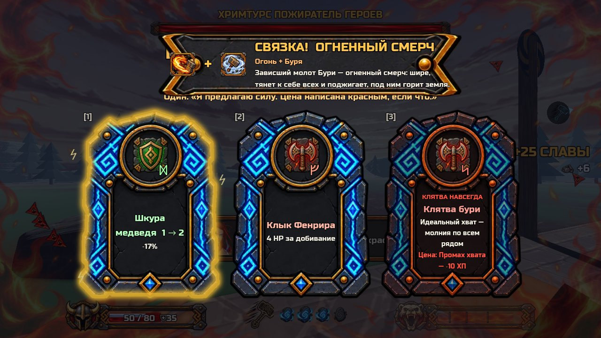

# Отчёт: партия 5 из NOW.md — П9, клятвы Одина, элита (29.10)

Сборка: [Windows ZIP из main 1889959](ThorDostoynayaSmert-windows.zip?raw=1) — 94,3 МБ, один EXE.

## Что сделано
1. **П9 ветки:** все 23 ветки проверил — список верный (16 с коммитами вне `main`, 7 уже целиком в `main`), **но создать метки и удалить ветки отсюда нельзя: GitHub отвечает 403**. Готов скрипт `tools/cleanup_branches.sh`: запусти у себя `bash tools/cleanup_branches.sh` (покажет план), затем с `--run` (сделает).
2. **Клятвы Одина (7):** в выборе рун после зала — примерно 1 раз из 3 последняя карточка — клятва: красная рамка, «КЛЯТВА НАВСЕГДА», цена красной строкой, под заголовком реплика Одина. Снять нельзя, взять — один раз. Иконки пока `runecat_*`.
3. **Элита:** новые **Магнит** (летящий молот тянет к нему), **Щит от бросков** (молот отскакивает и не ранит — бей вблизи или сверху), **Заземлённый** (стихии молота не действуют). Остались Взрывной, Вампир, Призыватель, Бронированный; Огненный, Ледяной, Быстрый из пула убраны.

## Проверить (до 3 минут каждое)
1. Клятвы: хочется ли брать — плюс ощутимый, цена честная?
2. Элита-Магнит и Щит от бросков: понятно ли сразу, что молот тут не работает и что делать?

## Проверено без тебя
- Тесты: 64 из 64; экспортированная игра проходит самопроверку.
- Клятвы: в 300 выборах клятва была в 106 (≈ 1 из 3), не больше одной за раз, в ларьке и наградах — нет; каждая клятва: плюс и цена работают по числам (урон ×1.4, лечение ×0.5, удар-приземление ×2, руны на земле стоят, молот ×1.6 / рука ×0.7, молния на хвате и −10 ХП за промах, Слава ×1.5 и двойной первый удар, скорость ×1.25 / +1 руна / здоровье ×0.75, руна +1 за зал без урона, отдых без лечения).
- Элита: в пуле ровно 7; брошенный мимо молот попадает в Магнит; Щит от бросков не получает урон от молота, но получает от мили и удара-приземления; по Заземлённому огонь, лёд и молния не наносят урона и не вешают состояния.

## Как понял спорное
- «Промах хвата» в Клятве бури — нажал ПКМ рано или поздно (не просто поймал без нажатия).
- Значков элиты в игре нет (только подпись над головой) — новые отличаются подписью и цветом.
