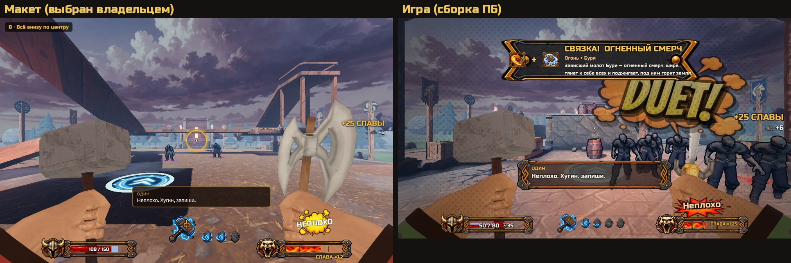
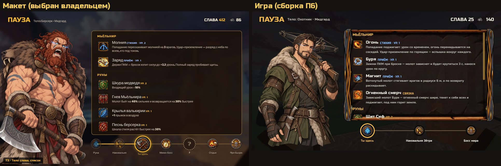

# Отчёт: партия 2 из NOW.md — П6, интерфейс (29.10)

Сборка: [Windows ZIP из main 5371187](ThorDostoynayaSmert-windows.zip?raw=1) — 94,2 МБ, один EXE.

## Что поменялось
1. **HUD по макету B:** всё внизу по центру — здоровье, Мьёльнир с рунами-камнями (перезарядка — затемнение иконки), шкала «ДОСТОЙНО!».
2. **В бою только главное:** Слава и серебро — всплывают «+25» на 2 с; оружие — на 2 с при смене; патроны — только со стволом; цифр урона нет (включаются в настройках).
3. **Tab — экран сборки по макету T3:** тело во весь рост, трейты и руны с описаниями, путь по миру, Слава и серебро; игра на паузе.
4. **Реплики:** один пузырь внизу, боевые — не чаще раза в 15 с; вороны — только когда рядом нет врагов.
5. **Шкалы высоты нет:** при падении нарастают линии скорости и свист, на большой высоте молот вспыхивает молнией, удар — «бум» и «Вот! ВОТ!».

## Проверить (до 3 минут каждое)
1. **Бой:** хватает ли на экране того, что осталось? Не потерялось ли нужное?
2. **Tab:** удобно ли смотреть сборку посреди зала?
3. **Прыжок с высоты:** чувствуется ли высота без шкалы?

## Проверено без тебя
- Тесты: 63 из 63, экспортированная игра проходит самопроверку (зал, враги).
- Что проверяют тесты: «+N» гаснет через 2 с; слоты оружия гаснут через 2 с; вторая боевая реплика раньше 15 с не проходит; ворон ждёт, пока рядом враг; Tab ставит паузу и показывает путь; при падении с 12 м растут линии и включается молния; цифры урона выключены.

## Идеи
- Геймпад: Tab — на крестовине вниз; стоит проверить, удобно ли.
