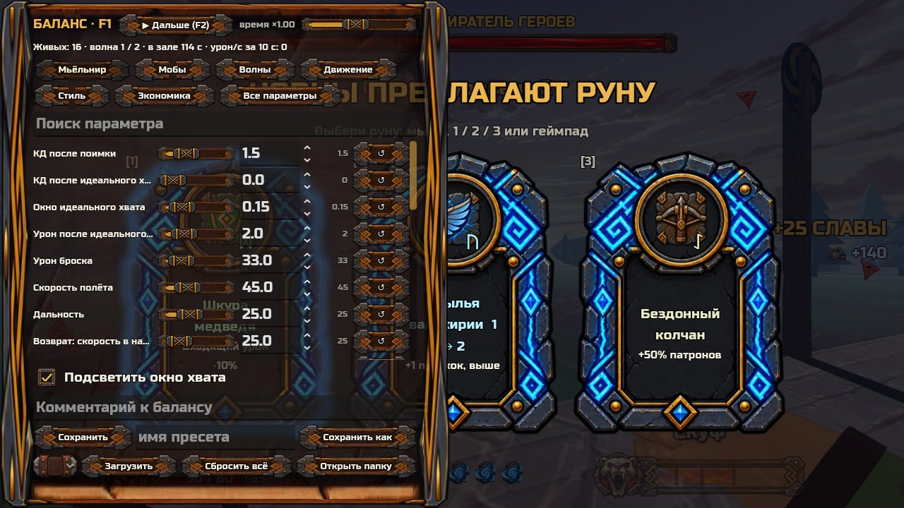

# Отчёт: партия 3 из NOW.md — П8, debug-панель баланса (29.10)

Сборка: [Windows ZIP из main af961c2](ThorDostoynayaSmert-windows.zip?raw=1) — 94,3 МБ, один EXE. Панель есть только в этой сборке для плейтеста.

## Что сделано
1. **F1 — панель баланса** слева, игра при этом идёт; **F2** — пауза; ползунок «время ×» (0.1–2, двойной клик — сброс).
2. **Вкладки:** Мьёльнир, Мобы, Волны, Движение, Стиль, Экономика и «Все параметры» (числа из кода появляются сами). Изменённое — жёлтым, на вкладке — счётчик; наведение — имя поля в коде.
3. **Мобы:** множители ХП (мобы / элита и мини-боссы / боссы), урона, скорости, замаха, пауз; галочка «к живым»; кнопки «+1/5/20 перед прицелом», «Убить всех», «Пропустить волну».
4. **Файл:** «Сохранить» пишет только изменённое в `user://debug/balance.json` (на Windows — `%APPDATA%\Godot\app_userdata\…\debug\`, кнопка «Открыть папку»), есть пресеты и комментарий. При следующем запуске игра подхватывает файл, слева внизу — плашка «Баланс из файла: N изм.».
5. **Перенос в код:** отдай мне `balance.json` — `tools/apply_balance.py` покажет «было → стало» и перенесёт числа.

## Проверить (до 3 минут каждое)
1. F1 в зале → «Окно идеального хвата» уже и шире → чувствуется ли разница?
2. «ХП мобов ×0.5», «Количество корма ×2» → бой ощущается по-другому?
3. «Сохранить» → перезапустить игру → есть ли плашка «Баланс из файла» и на месте ли значения?

## Проверено без тебя
- Тесты: 64 из 64, в том числе новый `debug_panel_test` (35 проверок) и самотест `apply_balance`; экспортированная игра проходит самопроверку.
- Что проверено: в обычной сборке панели нет; значение сразу у живого молота; ×0.5 ХП — у новых, с галочкой — и у живых; сохранить → сбросить → загрузить; кривые ключи не роняют игру; пауза и скорость времени не ломают хит-стоп.

## Отличия от ТЗ и вопрос
- «Рывков» меняет `dash_charges_max` (у тел свой запас, базовое число не действует); «Автовозврат через» действует только в старом режиме F6.
- Вопрос: множители мобов из твоего файла переносить в данные каждого врага или оставить общей константой? Решишь, когда пришлёшь файл.
